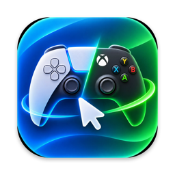
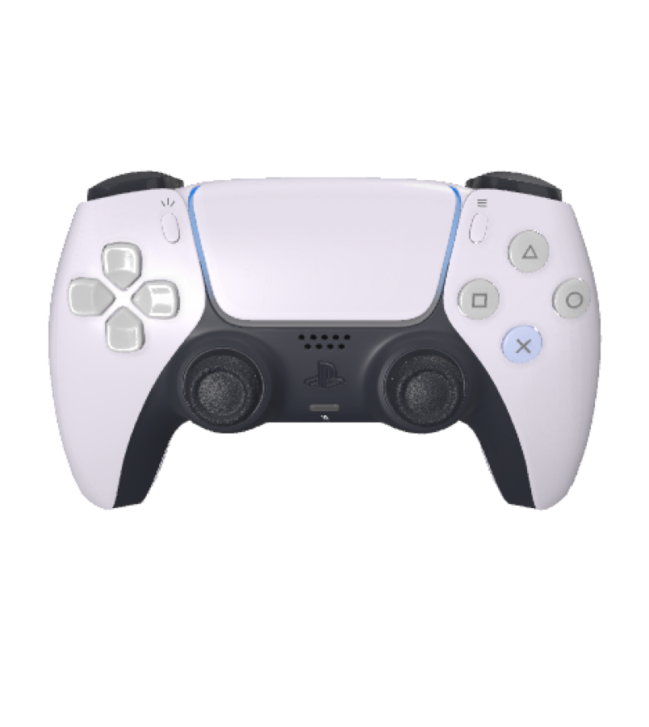
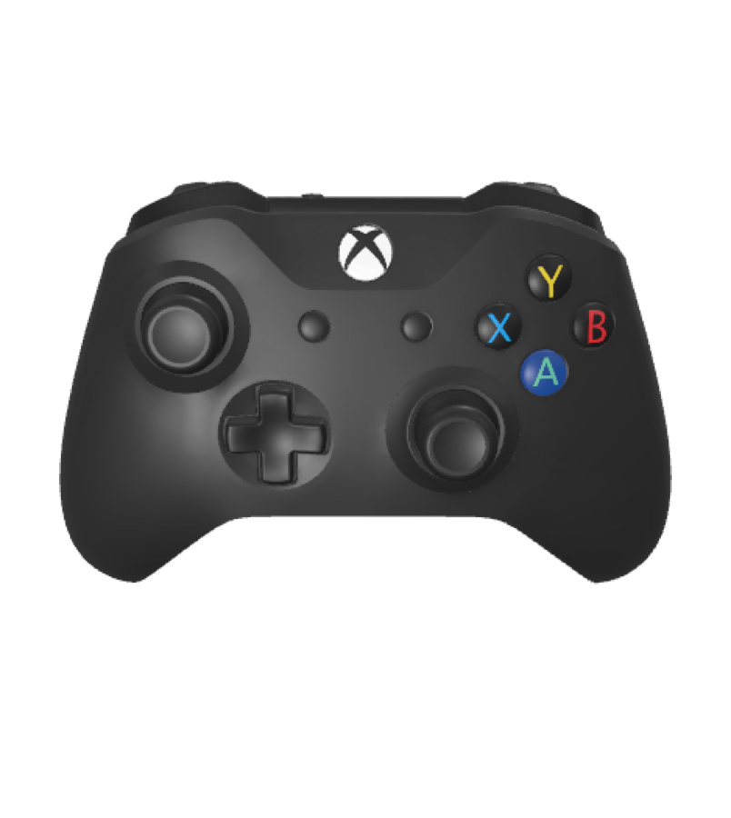

<p align="center">
  
</p>

<h1 align="center">PadFlow</h1>

<p align="center">
  Use a <b>PS5 DualSense</b> or <b>Xbox</b> controller as a mouse and keyboard on macOS.<br>
  ใช้จอย <b>PS5 DualSense</b> หรือ <b>Xbox</b> แทนเมาส์และคีย์บอร์ดบน Mac
</p>

<p align="center">
  <a href="#english">English</a> · <a href="#ภาษาไทย">ภาษาไทย</a>
</p>

<p align="center">
  
  
</p>

---

## English

### Features

- **Mouse control** — left stick moves the cursor, right stick scrolls, the DualSense touchpad works like a trackpad.
- **Clicks & drag** — ✕ / A = left click (hold to drag, double-tap = double-click), ○ / B = right click.
- **Volume, brightness, media** — native macOS volume/brightness HUD, play/pause, next/previous track.
- **Auto-detect** — recognises DualSense or Xbox on connect and switches the 3D model and button names.
- **Presets** — create, duplicate, import/export (JSON). Switch presets from the menu bar or straight from the controller.
- **Fully remappable** — 40+ actions or any custom key/shortcut, plus a second **Shift layer** (hold a button to use alternate actions).
- **Interactive 3D controller** — click a button on the model to remap it, drag to rotate; buttons press and sticks tilt live.
- **Speed tuning** — cursor speed, acceleration curve, dead zone, scroll speed, precision (L2) & boost (R2) on the triggers.
- **Light bar colour per preset** (DualSense).
- **Auto turn-off** — disconnects an idle Bluetooth controller after 5–60 min so its battery isn't drained.
- **Menu bar app** with English / Thai UI (English by default).

### Requirements

- macOS 13 Ventura or later (Apple Silicon or Intel)
- DualSense (PS5) or Xbox One / Series controller, via USB or Bluetooth

### Install

1. Download **PadFlow.dmg** from [Releases](../../releases/latest).
2. Open it and drag **PadFlow** onto **Applications**.
3. First launch: the app isn't notarized by Apple, so macOS will block it once.
   Open **System Settings → Privacy & Security** and click **Open Anyway** (or right-click the app → **Open**).
4. Grant **Accessibility** when asked (System Settings → Privacy & Security → Accessibility → enable PadFlow).
   This is required to move the cursor and send key presses.
5. Allow **Bluetooth** when asked (used only for the auto turn-off feature).

### Connect a controller

| Controller | Pairing |
|---|---|
| **DualSense** | Hold **PS + Create** until the light blinks, then pick it in System Settings → Bluetooth |
| **Xbox** | Turn it on, hold the **pair** button (top edge) until the logo blinks fast, then pick it in System Settings → Bluetooth |

A USB cable also works for both.

### Default controls (preset “Default”)

| Button (PS / Xbox) | Action | With **Create / View** held |
|---|---|---|
| Left stick | Move cursor | |
| Right stick | Scroll | |
| Touchpad (DualSense) | Move cursor like a trackpad; click = left click | |
| ✕ / A | Left click (hold = drag) | Play / pause |
| ○ / B | Right click | |
| □ / X | Esc | Screenshot (⇧⌘4) |
| △ / Y | Mission Control | Mute |
| L1 / LB | Back (⌘[) | Previous tab |
| R1 / RB | Forward (⌘]) | Next tab |
| L2 / LT | Precision (slower, analog) | |
| R2 / RT | Boost (faster, analog) | |
| L3 / LS | Middle click | |
| D-pad | Arrow keys | ↑↓ volume, ←→ brightness |
| Options / Menu | Toggle control on/off | Next preset |

Other built-in presets: **Movies / YouTube** and **Presentation**.

### Using the app

- **Menu bar icon** — status & battery, enable/disable, switch preset, language, open Settings, turn off controller.
- **Settings → Buttons** — click a button on the 3D model (or press it on the controller with *“press a controller button to select it”* on) and choose an action for *Normal press* and *While holding Shift*.
- **Settings → Sticks & speed** — what each stick does (cursor / scroll / arrow keys / unused) and all speed settings, with a live stick preview.
- **Settings → General** — controller status, active preset, auto turn-off, open at login, language, permissions.
- **Presets** — `+` new, `−` delete, duplicate; right-click a preset to export; `⋯` to import. Rename with the ✏️ button.

### Build from source

```bash
git clone https://github.com/Snow3all/PadFlow.git
cd PadFlow
./build.sh        # → build/PadFlow.app (universal, ad-hoc signed)
./make_dmg.sh     # → dist/PadFlow.dmg (drag-to-install window)
```

Only the Xcode Command Line Tools are needed (`xcode-select --install`), no Xcode project.

### Project structure

```
Sources/
  main.swift          App delegate, menu bar, settings window
  Engine.swift        Controller input → mouse/keyboard events, Bluetooth, battery, light bar
  Model.swift         Buttons, actions, presets, storage, EN/TH strings
  SettingsUI.swift    SwiftUI settings window
  Controller3D.swift  SceneKit 3D controller (real models + procedural fallback)
Resources/            3D models (.scn), textures, app icon
tools/                DMG background, icon setter, 3D model converters
build.sh, make_dmg.sh
```

### 3D models

`Resources/PadModel.scn` (DualSense) and `Resources/XboxModel.scn` are converted from the Sketchfab models credited below with the scripts in `tools/models/`. The converters split a single mesh into per-button parts by position, so they are tuned to those specific source models. If the `.scn` files are missing, PadFlow falls back to a procedurally built controller.

### Credits — 3D models (CC BY 4.0)

- **“Playstation 5 Dualsense”** by [AHarmlessPotato](https://sketchfab.com/AHarmlessPotato) — [Sketchfab](https://sketchfab.com/3d-models/playstation-5-dualsense-878c1f882808477ab81c2fe86d5a3936)
- **“Xbox Controller”** by [umkhero](https://sketchfab.com/umkhero) — [Sketchfab](https://sketchfab.com/3d-models/xbox-controller-32d17951703b4e05abed11a1c65f5909)

Both are licensed under [CC BY 4.0](https://creativecommons.org/licenses/by/4.0/). Changes: converted to SceneKit, split into per-button parts, re-oriented/rescaled, textures resized. See [CREDITS.md](CREDITS.md).

### Trademarks

PlayStation, DualSense and SONY are trademarks of Sony Interactive Entertainment; Xbox is a trademark of Microsoft. This project is not affiliated with or endorsed by Sony or Microsoft.

### License

[MIT](LICENSE) © Snow3all — you may use, modify and redistribute PadFlow, as long as the copyright notice and license are kept (i.e. credit the original project). The MIT license applies to the PadFlow source code; the 3D models keep their own CC BY 4.0 license.

---

## ภาษาไทย

### ความสามารถ

- **คุมเมาส์ด้วยจอย** — สติ๊กซ้ายขยับเคอร์เซอร์ สติ๊กขวาเลื่อนหน้าจอ ทัชแพดของ DualSense ใช้แทน trackpad ได้
- **คลิกและลาก** — ✕ / A = คลิกซ้าย (กดค้างเพื่อลาก กดสองครั้งเป็นดับเบิลคลิก) ○ / B = คลิกขวา
- **ปรับเสียง แสงหน้าจอ และคุมเพลง** — แสดงแถบเสียง/แสงของ macOS เหมือนกดคีย์บอร์ดจริง
- **ตรวจชนิดจอยอัตโนมัติ** — ต่อ DualSense หรือ Xbox แล้วแอปจะเปลี่ยนโมเดล 3D และชื่อปุ่มให้ตรงกันเอง
- **Preset** — สร้าง ทำสำเนา นำเข้า/ส่งออกเป็นไฟล์ JSON สลับ Preset ได้จากเมนูหรือกดจากจอยได้เลย
- **ตั้งปุ่มเองได้ทุกปุ่ม** — มีคำสั่งให้เลือกกว่า 40 แบบ หรือกำหนดคีย์/คีย์ลัดเองได้ และมี **ชุดที่ 2 (Shift)** กดปุ่ม Shift ค้างเพื่อใช้คำสั่งอีกชุด
- **จอย 3D** — คลิกปุ่มบนโมเดลเพื่อตั้งค่า ลากเพื่อหมุน ปุ่มยุบและสติ๊กเอียงตามจอยจริง
- **ปรับความเร็ว** — ความเร็วเคอร์เซอร์ ความโค้ง ระยะที่ไม่ตอบสนอง (dead zone) ความเร็วการเลื่อน และไก L2/R2 ใช้ช้าลง/เร่งความเร็วแบบอนาล็อก
- **ตั้งสีไฟจอยแยกตาม Preset** (DualSense)
- **ปิดจอยอัตโนมัติ** เมื่อไม่ได้ใช้ 5–60 นาที ช่วยประหยัดแบต
- **แอปบนแถบเมนู** มีภาษาอังกฤษและไทย (ค่าเริ่มต้นเป็นอังกฤษ)

### ต้องใช้อะไรบ้าง

- macOS 13 Ventura ขึ้นไป (Apple Silicon หรือ Intel)
- จอย DualSense (PS5) หรือ Xbox One / Series ต่อด้วยสาย USB หรือ Bluetooth

### วิธีติดตั้ง

1. ดาวน์โหลด **PadFlow.dmg** จากหน้า [Releases](../../releases/latest)
2. เปิดไฟล์ แล้วลาก **PadFlow** ไปวางที่ **Applications**
3. เปิดครั้งแรก macOS จะบล็อกไว้หนึ่งครั้ง เพราะแอปไม่ได้ผ่านการตรวจ (notarize) ของ Apple
   ไปที่ **System Settings → Privacy & Security** แล้วกด **Open Anyway** (หรือคลิกขวาที่แอป → **Open**)
4. อนุญาต **Accessibility** เมื่อระบบถาม (System Settings → Privacy & Security → Accessibility → เปิด PadFlow)
   จำเป็นสำหรับการขยับเมาส์และส่งการกดคีย์
5. อนุญาต **Bluetooth** เมื่อระบบถาม (ใช้สำหรับปิดจอยอัตโนมัติเท่านั้น)

### เชื่อมต่อจอย

| จอย | วิธีจับคู่ |
|---|---|
| **DualSense** | กด **PS + Create** ค้างจนไฟกะพริบ แล้วเลือกจอยใน System Settings → Bluetooth |
| **Xbox** | เปิดจอย แล้วกดปุ่ม **จับคู่** (ขอบบน) ค้างจนโลโก้กะพริบเร็ว แล้วเลือกจอยใน System Settings → Bluetooth |

ต่อสาย USB ก็ใช้ได้ทั้งสองแบบ

### ปุ่มเริ่มต้น (Preset “Default”)

| ปุ่ม (PS / Xbox) | คำสั่ง | เมื่อกด **Create / View** ค้าง |
|---|---|---|
| สติ๊กซ้าย | ขยับเคอร์เซอร์ | |
| สติ๊กขวา | เลื่อนหน้าจอ | |
| ทัชแพด (DualSense) | ลากนิ้วขยับเคอร์เซอร์ กดลงไป = คลิกซ้าย | |
| ✕ / A | คลิกซ้าย (กดค้าง = ลาก) | เล่น/หยุดเพลง |
| ○ / B | คลิกขวา | |
| □ / X | Esc | จับภาพหน้าจอ (⇧⌘4) |
| △ / Y | Mission Control | ปิด/เปิดเสียง |
| L1 / LB | ย้อนกลับ (⌘[) | แท็บก่อนหน้า |
| R1 / RB | ไปข้างหน้า (⌘]) | แท็บถัดไป |
| L2 / LT | ช้าลง เล็งให้แม่น (อนาล็อก) | |
| R2 / RT | เร่งความเร็ว (อนาล็อก) | |
| L3 / LS | คลิกกลาง | |
| D-pad | ปุ่มลูกศร | ↑↓ เสียง, ←→ แสงหน้าจอ |
| Options / Menu | เปิด/ปิดการควบคุม | Preset ถัดไป |

Preset อื่นที่มากับแอป: **Movies / YouTube** และ **Presentation**

### วิธีใช้งาน

- **ไอคอนบนแถบเมนู** — ดูสถานะและแบต เปิด/ปิดการควบคุม สลับ Preset เปลี่ยนภาษา เปิดหน้าตั้งค่า และปิดจอย
- **Settings → Buttons** — คลิกปุ่มบนโมเดล 3D (หรือเปิดสวิตช์ *กดปุ่มบนจอยเพื่อเลือก* แล้วกดปุ่มจริง) จากนั้นเลือกคำสั่งสำหรับ *กดปกติ* และ *กดพร้อม Shift*
- **Settings → Sticks & speed** — ตั้งว่าสติ๊กแต่ละข้างทำอะไร (เคอร์เซอร์ / เลื่อนหน้าจอ / ปุ่มลูกศร / ไม่ใช้) และปรับความเร็วต่างๆ พร้อมดูตำแหน่งสติ๊กแบบสด
- **Settings → General** — สถานะจอย Preset ที่ใช้ ปิดจอยอัตโนมัติ เปิดแอปตอนเข้าเครื่อง ภาษา และสิทธิ์ต่างๆ
- **Preset** — `+` สร้างใหม่ `−` ลบ ทำสำเนาได้ คลิกขวาเพื่อส่งออก ปุ่ม `⋯` สำหรับนำเข้า เปลี่ยนชื่อด้วยปุ่ม ✏️

### Build เองจากซอร์สโค้ด

```bash
git clone https://github.com/Snow3all/PadFlow.git
cd PadFlow
./build.sh        # → build/PadFlow.app
./make_dmg.sh     # → dist/PadFlow.dmg
```

ใช้แค่ Xcode Command Line Tools (`xcode-select --install`) ไม่ต้องมีโปรเจกต์ Xcode

### โมเดล 3D

`Resources/PadModel.scn` (DualSense) และ `Resources/XboxModel.scn` แปลงมาจากโมเดลบน Sketchfab (ดูเครดิตด้านล่าง) ด้วยสคริปต์ใน `tools/models/` ซึ่งจะแยกชิ้นส่วนตามตำแหน่งปุ่ม จึงตั้งค่าไว้เฉพาะโมเดลต้นฉบับชุดนั้น ถ้าไม่มีไฟล์ `.scn` แอปจะใช้โมเดลที่สร้างจากโค้ดแทน

### เครดิตโมเดล 3D (CC BY 4.0)

- **“Playstation 5 Dualsense”** โดย [AHarmlessPotato](https://sketchfab.com/AHarmlessPotato) — [Sketchfab](https://sketchfab.com/3d-models/playstation-5-dualsense-878c1f882808477ab81c2fe86d5a3936)
- **“Xbox Controller”** โดย [umkhero](https://sketchfab.com/umkhero) — [Sketchfab](https://sketchfab.com/3d-models/xbox-controller-32d17951703b4e05abed11a1c65f5909)

ทั้งสองโมเดลใช้ license [CC BY 4.0](https://creativecommons.org/licenses/by/4.0/) สิ่งที่แก้: แปลงเป็น SceneKit แยกชิ้นตามปุ่ม หมุนและปรับขนาด ย่อ texture รายละเอียดดูที่ [CREDITS.md](CREDITS.md)

### เครื่องหมายการค้า

PlayStation, DualSense และ SONY เป็นเครื่องหมายการค้าของ Sony Interactive Entertainment ส่วน Xbox เป็นเครื่องหมายการค้าของ Microsoft โปรเจกต์นี้ไม่มีส่วนเกี่ยวข้องและไม่ได้รับการรับรองจาก Sony หรือ Microsoft

### License

[MIT](LICENSE) © Snow3all — นำไปใช้ แก้ไข และแจกต่อได้ โดยต้องเก็บข้อความลิขสิทธิ์และ license ไว้ (คือให้เครดิตโปรเจกต์ต้นฉบับ) license นี้ครอบคลุมซอร์สโค้ดของ PadFlow ส่วนโมเดล 3D ยังใช้ license CC BY 4.0 ของผู้สร้างเดิม
